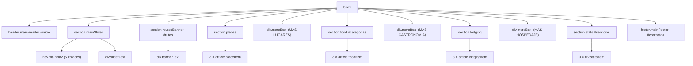

# 🗺️ RutaTurística: cómo se conecta cada etiqueta HTML con el CSS

> Guía de estudio de la práctica **RutaTurística** (Ingeniería Web, UTPL).
> Está pensada para leerla con `index.html` y `css/styles.css` abiertos al lado.
> Orden de la guía = orden en que aparecen las secciones en la página, de arriba hacia abajo.

**Leyenda**

| Icono | Significa |
|---|---|
| 🔗 | Conexión HTML ↔ CSS (el "cómo se encuentra") |
| 🧱 | Estructura (HTML) |
| 🎨 | Estilo (CSS) |
| ⚠️ | Detalle que suele preguntarse o confundirse |

---

## Índice

1. [Visión general del proyecto](#1-visión-general-del-proyecto)
2. [Las formas de conectar HTML con CSS que usa este proyecto](#2-las-formas-de-conectar-html-con-css-que-usa-este-proyecto)
3. [`<head>`: cómo se carga el CSS y los íconos](#3-head-cómo-se-carga-el-css-y-los-íconos)
4. [Reglas globales del CSS](#4-reglas-globales-del-css)
5. [Cabecera (`header.mainHeader`)](#5-cabecera-headermainheader)
6. [Slider principal y menú (`section.mainSlider`)](#6-slider-principal-y-menú-sectionmainslider)
7. [Banner "Lugares para visitar" y tarjetas](#7-banner-lugares-para-visitar-y-tarjetas)
8. [Botón hexágono "+" (`div.moreBox`)](#8-botón-hexágono--divmorebox)
9. [Gastronomía (`section.food`)](#9-gastronomía-sectionfood)
10. [Hospedaje (`section.lodging`)](#10-hospedaje-sectionlodging)
11. [Contadores (`section.stats`)](#11-contadores-sectionstats)
12. [Pie de página (`footer.mainFooter`)](#12-pie-de-página-footermainfooter)
13. [El menú interactivo (anclas)](#13-el-menú-interactivo-anclas)
14. [Patrones que se repiten en todo el proyecto](#14-patrones-que-se-repiten-en-todo-el-proyecto)
15. [Cómo comprobarlo tú mismo (F12)](#15-cómo-comprobarlo-tú-mismo-f12)
16. [Preguntas de práctica](#16-preguntas-de-práctica)

---

## 1. Visión general del proyecto

### 1.1 Archivos

```
Proyecto/
├── index.html          ← la estructura (🧱)
├── css/
│   └── styles.css      ← la presentación (🎨)
└── images/             ← playa, volcan1, volcan2, coati, iguana,
                           sopa, salmon, carne, hotel1, hotel2, hotel3
```

### 1.2 Árbol de la página (qué contiene qué)



### 1.3 Idea central

> **HTML dice QUÉ es cada cosa. CSS dice CÓMO se ve.**
> El puente entre los dos son los **nombres**: la etiqueta (`section`), la clase (`class="news"`) y el id (`id="rutas"`).

---

## 2. Las formas de conectar HTML con CSS que usa este proyecto

Esta tabla es la clave de todo. Cada vez que veas un selector en el CSS, ubícalo aquí.

| Tipo | Cómo se escribe en CSS | Ejemplo real del proyecto | Qué elementos del HTML alcanza |
|---|---|---|---|
| **Universal** | `*` | `*{ ... }` | **Todos** los elementos |
| **Etiqueta** | `nombre` | `html{ ... }`, `body{ ... }` | Todas las etiquetas con ese nombre |
| **Etiqueta + clase** (pegado, sin espacio) | `etiqueta.clase` | `header.mainHeader` | Un `<header>` que **tenga** `class="mainHeader"` |
| **Descendiente** (con espacio) | `A B` | `header.mainHeader .logoBox` | Un `.logoBox` que esté **dentro de** `header.mainHeader` (a cualquier nivel) |
| **Cadena de descendientes** | `A B C` | `section.mainSlider nav.mainNav a` | Un `<a>` dentro de `nav.mainNav` dentro de `section.mainSlider` |
| **Grupo** (coma) | `A, B, C` | `section.food, section.lodging` | Aplica **la misma regla** a todos los de la lista |
| **Pseudo-clase** | `selector:estado` | `nav.mainNav a:hover` | El elemento **solo cuando** el mouse está encima |
| **Pseudo-elemento** | `selector:before` | `div.moreBox:before` | Una caja **inventada por el CSS** que aparece antes del contenido del elemento |
| **Etiqueta + clase de ícono** | `i.bxl-twitter` | `footer.mainFooter .footerSocial i.bxl-twitter` | Solo los `<i>` que tienen esa clase concreta |
| **id (ancla)** | `href="#id"` en HTML | `href="#rutas"` ↔ `id="rutas"` | **No lo usa el CSS**: lo usa el menú para navegar (ver [sección 13](#13-el-menú-interactivo-anclas)) |

### ⚠️ Diferencia que más se pregunta

| Escribes | Significa |
|---|---|
| `header.mainHeader` | El `<header>` **que tiene** la clase (pegado) |
| `header .mainHeader` | Algo con esa clase **dentro de** un `<header>` (con espacio) |
| `header.mainHeader, section.mainSlider` | **Dos** selectores distintos con la misma regla (coma) |

### 2.1 Cómo "gana" una regla cuando hay conflicto (cascada y especificidad)

Orden de menor a mayor fuerza: `*` < etiqueta < clase < id < estilo en línea. Si dos reglas tienen la misma fuerza, **gana la que está más abajo** en el archivo.

Casos reales de este proyecto:

| Situación | Quién gana y por qué |
|---|---|
| `*{ font-family: "Montserrat" }` vs. los íconos `<i class="bx ...">` | Los íconos de Boxicons definen su propia fuente con un selector de **clase** (`.bx`), que es más fuerte que `*`. Por eso los íconos se ven como íconos y no como letras. |
| El grupo `section.places, ...{ margin: 0 auto }` y luego `section.places{ margin-top: 20px }` | Misma fuerza, pero la segunda está **más abajo**: `margin-top` pasa a 20px, mientras los lados siguen en `auto` (porque la segunda regla solo toca `margin-top`). |
| `section.food, section.lodging{ text-align: center }` vs. `.foodText{ text-align: left }` | `.foodText` es un selector más específico (más largo) y está más abajo: dentro de esa caja el texto va a la izquierda. |

---

## 3. `<head>`: cómo se carga el CSS y los íconos

### 🧱 HTML

```html
<!DOCTYPE html>
<html>
<head>
	<meta charset="utf-8">
	<meta name="viewport" content="width=device-width, initial-scale=1">
	<title>RutaTuristica</title>
	<link rel="stylesheet" type="text/css" href="css/styles.css">
	<link href="https://unpkg.com/boxicons@2.1.4/css/boxicons.min.css" rel="stylesheet">
</head>
```

### Línea por línea

| Línea | Qué hace |
|---|---|
| `<!DOCTYPE html>` | Declara que el documento es HTML5. |
| `<html>` | Elemento raíz. Todo va dentro. (Es el elemento al que apunta el selector CSS `html`.) |
| `<meta charset="utf-8">` | Codificación de caracteres: permite tildes y la ñ ("Categorías", "costeña"). |
| `<meta name="viewport" ...>` | Hace que el ancho se adapte a pantallas de móvil. |
| `<title>` | Texto de la pestaña del navegador. |
| `<link rel="stylesheet" type="text/css" href="css/styles.css">` | 🔗 **El puente HTML → CSS.** `rel="stylesheet"` = "esto es una hoja de estilos". `href="css/styles.css"` = ruta **relativa** desde `index.html`: entra a la carpeta `css` y toma `styles.css`. |
| `<link href="https://unpkg.com/boxicons@2.1.4/..." rel="stylesheet">` | 🔗 Carga **Boxicons** desde un CDN (servidor externo). Es lo que hace que `<i class="bx bx-world">` se dibuje como ícono. **Necesita internet.** |

### ⚠️ Rutas relativas: quién está dónde

| Dónde está escrita la ruta | Ruta | Resuelve a |
|---|---|---|
| En `index.html` (raíz) | `css/styles.css` | `Proyecto/css/styles.css` |
| En `index.html` | `images/playa.jpg` | `Proyecto/images/playa.jpg` |
| **Dentro de `styles.css`** | `../images/playa.jpg` | `..` = "sube una carpeta" (de `css/` a `Proyecto/`), luego `images/playa.jpg` |

> Las rutas dentro del CSS se cuentan **desde donde está el archivo CSS**, no desde el HTML. Por eso allí hay un `../`.

---

## 4. Reglas globales del CSS

### 🎨 CSS

```css
@import url('https://fonts.googleapis.com/css2?family=Montserrat:ital,wght@0,100..900;1,100..900&display=swap');

*{
	padding: 0;
	margin: 0;
	box-sizing: border-box;
	font-family: "Montserrat", sans-serif;
}
html{
	scroll-behavior: smooth;
}
body{
	background-color: #f3f3f3;
	color: #666;
}
/* -------------Ancho general de las secciones ------------- */
header.mainHeader, section.mainSlider, section.routesBanner, section.places, section.food, section.lodging, div.moreBox, section.stats, footer.mainFooter{
	width: 80%;
	margin: 0 auto;
}
```

### Explicación

| Regla | 🔗 A qué elementos llega | Qué hace |
|---|---|---|
| `@import url(...)` | (no es un selector) | Trae la fuente **Montserrat** de Google Fonts. `wght@0,100..900` pide **todos los grosores** del 100 al 900 (por eso funcionan `font-weight: 300`, `500`, `600`, `700`). `display=swap` muestra una fuente de respaldo mientras carga. |
| `*{ padding:0; margin:0 }` | **Todos** los elementos | Quita los espacios que el navegador pone por defecto, para empezar desde cero y controlar cada espacio. |
| `box-sizing: border-box` | Todos | El `width` **incluye** padding y borde. Sin esto, `width: 80%` + `padding` se desbordaría. |
| `font-family: "Montserrat", sans-serif` | Todos | Fuente de toda la página. `sans-serif` es el **respaldo** si Montserrat no carga. |
| `html{ scroll-behavior: smooth }` | La etiqueta `<html>` | Hace que, al hacer clic en el menú, la página **se deslice suavemente** en vez de saltar. (Ver [sección 13](#13-el-menú-interactivo-anclas).) |
| `body{ background-color: #f3f3f3 }` | La etiqueta `<body>` | Fondo gris muy claro de toda la página. |
| `body{ color: #666 }` | `<body>` | Color de texto gris. **Se hereda**: todo el texto lo toma salvo que un elemento defina otro color. |
| Grupo de 9 selectores | Los 9 contenedores principales | `width: 80%` = ocupan el 80% del ancho del navegador. `margin: 0 auto` = **centrados** (0 arriba/abajo, `auto` a los lados). Una sola regla para todos = **reutilización**. |

> ⚠️ **Herencia:** propiedades como `color` y `font-size` se **heredan** de padre a hijo; `width`, `margin`, `padding` y `background` **no**.

---

## 5. Cabecera (`header.mainHeader`)

Es la franja blanca de arriba: logo, teléfono, correo y ubicación.

### 🧱 HTML

```html
<header class="mainHeader" id="inicio">
	<div class="logoBox">
		<i class="bx bx-world"></i>
		<div>
			<h2>RutaTurística</h2>
			<p>Los mejores lugares de turismo</p>
		</div>
	</div>
	<div class="infoItem">
		<i class="bx bxs-phone"></i>
		<p>(593) 0997574718</p>
	</div>
	<div class="infoItem">
		<i class="bx bxs-envelope"></i>
		<p>info@turuta.com</p>
	</div>
	<div class="infoItem">
		<i class="bx bx-map-pin"></i>
		<p>18 de noviembre 12:45 y Colón, Loja</p>
	</div>
</header>
```

### 🎨 CSS

```css
header.mainHeader{
	display: flex;
	justify-content: space-between;
	align-items: center;
	background-color: #fff;
	padding: 12px 15px;
}
header.mainHeader .logoBox{
	display: flex;
	align-items: center;
}
header.mainHeader .logoBox i{
	font-size: 34px;
	color: #2d9cdb;
	margin-right: 10px;
}
header.mainHeader .logoBox h2{
	font-size: 22px;
	font-weight: 500;
	color: #5cb83c;
}
header.mainHeader .logoBox p{
	font-size: 8px;
}
header.mainHeader .infoItem{
	display: flex;
	align-items: center;
	font-size: 11px;
}
header.mainHeader .infoItem i{
	background-color: #2d9cdb;
	color: #fff;
	font-size: 20px;
	padding: 5px;
	border-radius: 4px;
	margin-right: 8px;
}
```

### 🔗 Mapa HTML → CSS

| Línea HTML | Selector CSS que la alcanza | Por qué la encuentra |
|---|---|---|
| `<header class="mainHeader" id="inicio">` | `header.mainHeader` (y también el grupo de la sección 4) | Etiqueta `header` **con** clase `mainHeader`. El `id="inicio"` **no se usa en CSS**: es el destino del enlace INICIO. |
| `<div class="logoBox">` | `header.mainHeader .logoBox` | Clase `logoBox` **dentro de** el header. |
| `<i class="bx bx-world">` | `header.mainHeader .logoBox i` | Etiqueta `i` dentro de `.logoBox`. (Las clases `bx bx-world` las usa Boxicons para dibujar el mundo.) |
| `<div>` sin clase (envuelve h2 y p) | **Ninguna regla** | Solo agrupa el título y la frase para que queden **uno bajo el otro** al lado del ícono. |
| `<h2>RutaTurística</h2>` | `header.mainHeader .logoBox h2` | `h2` dentro de `.logoBox`. |
| `<p>Los mejores lugares...</p>` | `header.mainHeader .logoBox p` | `p` dentro de `.logoBox`. |
| `<div class="infoItem">` (×3) | `header.mainHeader .infoItem` | Las **tres** tienen la misma clase → una sola regla las estiliza. |
| `<i class="bx bxs-phone">` (y envelope, map-pin) | `header.mainHeader .infoItem i` | Etiqueta `i` dentro de `.infoItem`. |
| `<p>` dentro de `.infoItem` | **Ninguna regla propia** | Hereda `font-size: 11px` desde `.infoItem` y el color gris desde `body`. |

### 🎨 Qué hace cada propiedad

| Selector | Propiedad | Qué hace |
|---|---|---|
| `header.mainHeader` | `display: flex` | Convierte al header en **contenedor flexible**: sus hijos directos (`.logoBox` y los 3 `.infoItem`) se colocan **en una fila**. |
| | `justify-content: space-between` | Reparte el espacio sobrante **entre** los 4 bloques (el primero pegado a la izquierda, el último a la derecha). |
| | `align-items: center` | Los centra **verticalmente** entre sí. |
| | `background-color: #fff` | Fondo blanco. |
| | `padding: 12px 15px` | 12px arriba/abajo, 15px izquierda/derecha. |
| `.logoBox` | `display: flex; align-items: center` | El ícono y el bloque de texto quedan **lado a lado** y centrados verticalmente. |
| `.logoBox i` | `font-size: 34px` | **Tamaño del ícono** (los íconos de fuente se agrandan con `font-size`). |
| | `color: #2d9cdb` | **Color del ícono** (azul). |
| | `margin-right: 10px` | Separa el ícono del texto. |
| `.logoBox h2` | `font-size: 22px; font-weight: 500; color: #5cb83c` | Título verde de grosor medio. |
| `.logoBox p` | `font-size: 8px` | Frase pequeña. |
| `.infoItem` | `display: flex; align-items: center` | Ícono y texto en fila, centrados. |
| | `font-size: 11px` | Tamaño del texto del `<p>` (**heredado** por el hijo). |
| `.infoItem i` | `background-color: #2d9cdb; color: #fff` | Cuadradito azul con ícono blanco. |
| | `padding: 5px; border-radius: 4px` | Espacio interior y esquinas redondeadas. |
| | `margin-right: 8px` | Separación con el texto. |

---

## 6. Slider principal y menú (`section.mainSlider`)

Es la foto grande de la playa con el **menú verde** arriba y la **caja blanca translúcida** abajo.

### 🧱 HTML

```html
<section class="mainSlider">
	<nav class="mainNav">
		<a href="#inicio">INICIO</a>
		<a href="#categorias">CATEGORÍAS</a>
		<a href="#servicios">SERVICIOS</a>
		<a href="#rutas">RUTAS</a>
		<a href="#contactos">CONTACTOS</a>
	</nav>
	<div class="sliderText">
		<h2>DISFRUTA DEL ENCANTO DE NUESTRA CIUDAD</h2>
		<p>Conoce los diferentes atractivos turísticos y disfruta de su encanto</p>
	</div>
</section>
```

### 🎨 CSS

```css
section.mainSlider{
	position: relative;
	height: 420px;
	background: url('../images/playa.jpg') no-repeat center center;
	background-size: cover;
}
section.mainSlider nav.mainNav{
	position: absolute;
	top: 0;
	left: 0;
	width: 100%;
	background-color: #5cb83c;
	text-align: center;
}
section.mainSlider nav.mainNav a{
	display: inline-block;
	text-decoration: none;
	color: #fff;
	font-size: 11px;
	font-weight: 600;
	padding: 14px 28px;
}
section.mainSlider nav.mainNav a:hover{
	background-color: #3f8f27;
	color: #fff;
}
section.mainSlider .sliderText{
	position: absolute;
	bottom: 0;
	left: 7%;
	width: 86%;
	background-color: rgba(255, 255, 255, .75);
	text-align: center;
	padding: 25px 20px;
}
section.mainSlider .sliderText h2{
	font-size: 26px;
	font-weight: 700;
	color: #3b8bc9;
}
section.mainSlider .sliderText p{
	font-size: 17px;
	color: #555;
	margin-top: 8px;
}
```

### 🔗 Mapa HTML → CSS

| Línea HTML | Selector CSS | Por qué la encuentra |
|---|---|---|
| `<section class="mainSlider">` | `section.mainSlider` (+ grupo de la sección 4) | Etiqueta + clase. |
| `<nav class="mainNav">` | `section.mainSlider nav.mainNav` | `nav` con clase `mainNav` **dentro de** `section.mainSlider`. |
| Cada `<a href="#...">` (×5) | `section.mainSlider nav.mainNav a` | Cadena de 3 niveles: section → nav → a. Los **cinco** enlaces reciben el mismo estilo. |
| Un `<a>` con el mouse encima | `section.mainSlider nav.mainNav a:hover` | Misma cadena + pseudo-clase `:hover`. |
| `<div class="sliderText">` | `section.mainSlider .sliderText` | Clase dentro de la section. |
| `<h2>` dentro de `.sliderText` | `section.mainSlider .sliderText h2` | `h2` dentro de `.sliderText`. |
| `<p>` dentro de `.sliderText` | `section.mainSlider .sliderText p` | `p` dentro de `.sliderText`. |

### 🎨 Qué hace cada propiedad

| Selector | Propiedad | Qué hace |
|---|---|---|
| `section.mainSlider` | `position: relative` | ⭐ La convierte en el **punto de referencia** para sus hijos con `position: absolute` (el menú y la caja de texto). |
| | `height: 420px` | **Altura fija.** Es necesaria: como los hijos son `absolute` (salen del flujo), sin altura la sección mediría 0 y no se vería la foto. |
| | `background: url('../images/playa.jpg') no-repeat center center` | Foto de fondo. `no-repeat` = no se repite; `center center` = centrada horizontal y verticalmente. |
| | `background-size: cover` | La foto **cubre toda la caja** sin deformarse (recorta lo que sobra). |
| `nav.mainNav` | `position: absolute; top: 0; left: 0` | Se pega a la **esquina superior izquierda** de `section.mainSlider` (no de la página), y queda **encima** de la foto. |
| | `width: 100%` | Ocupa todo el ancho de la sección. |
| | `background-color: #5cb83c` | Barra verde. |
| | `text-align: center` | Los enlaces quedan centrados. |
| `nav.mainNav a` | `display: inline-block` | Se ponen **en fila** pero aceptan `padding` vertical (un `<a>` normal es `inline` y no empujaría la barra). |
| | `text-decoration: none` | Quita el subrayado. |
| | `color: #fff; font-size: 11px; font-weight: 600` | Texto blanco, pequeño, semi-negrita. |
| | `padding: 14px 28px` | 14px arriba/abajo, 28px a los lados: define el **tamaño del botón** y la altura de la barra verde. |
| `a:hover` | `background-color: #3f8f27` | Al pasar el mouse, el fondo se oscurece. |
| `.sliderText` | `position: absolute; bottom: 0` | Pegada al **borde inferior** de la sección. |
| | `left: 7%; width: 86%` | 7% + 86% + 7% = 100% → **centrada**. |
| | `background-color: rgba(255,255,255,.75)` | Blanco con **75% de opacidad** (rgba = rojo, verde, azul, **alfa**). Deja ver la foto detrás. |
| | `text-align: center; padding: 25px 20px` | Texto centrado y con aire interior. |
| `.sliderText h2` | `font-size: 26px; font-weight: 700; color: #3b8bc9` | Título azul en negrita. |
| `.sliderText p` | `font-size: 17px; color: #555; margin-top: 8px` | Subtítulo gris, separado 8px del título. |

> ⚠️ **Patrón `relative` + `absolute`:** el padre lleva `position: relative` y el hijo `position: absolute`; así `top`, `bottom`, `left` y `width: %` del hijo se miden **respecto al padre**. Se repite en `moreBox` y `foodItem`.

---

## 7. Banner "Lugares para visitar" y tarjetas

### 🧱 HTML

```html
<section class="routesBanner" id="rutas">
	<div class="bannerText">
		<h2>LUGARES PARA VISITAR EN TU RUTA</h2>
		<p>Visita los lugares que te sugerimos y podras disfrutar de los encantos de nuestra ciudad</p>
	</div>
</section>
<section class="places">
	<article class="placeItem">
		
		<h3>Laguna de piedra</h3>
		<p>Laguna de piedra ubicada en el noroxidente del canton Loja, ...</p>
	</article>
	<article class="placeItem">
		
		<h3>Zoologico de Loja</h3>
		<p>...</p>
	</article>
	<article class="placeItem">
		
		<h3>Playa Salinas</h3>
		<p>...</p>
	</article>
</section>
```

### 🎨 CSS

```css
section.routesBanner{
	background: url('../images/volcan1.jpg') no-repeat center center;
	background-size: cover;
	padding: 15px 4%;
	margin-top: 20px;
}
section.routesBanner .bannerText{
	background-color: rgba(0, 0, 0, .75);
	color: #fff;
	padding: 35px 40px;
}
section.routesBanner .bannerText h2{
	font-size: 22px;
	font-weight: 700;
}
section.routesBanner .bannerText p{
	font-size: 13px;
	margin-top: 8px;
}
section.places{
	display: flex;
	justify-content: space-between;
	margin-top: 20px;
	padding: 0 4%;
}
section.places .placeItem{
	width: 31%;
}
section.places .placeItem img{
	width: 100%;
	height: 150px;
	object-fit: cover;
	display: block;
}
section.places .placeItem h3{
	font-size: 13px;
	margin: 18px 0 12px 5px;
}
section.places .placeItem p{
	font-size: 10px;
	line-height: 1.6;
	margin-left: 5px;
}
```

### 🔗 Mapa HTML → CSS

| Línea HTML | Selector CSS | Por qué |
|---|---|---|
| `<section class="routesBanner" id="rutas">` | `section.routesBanner` | Etiqueta + clase. `id="rutas"` = destino del enlace RUTAS. |
| `<div class="bannerText">` | `section.routesBanner .bannerText` | La **caja negra translúcida** dentro del banner. |
| `<h2>` / `<p>` dentro de `.bannerText` | `... .bannerText h2` / `... .bannerText p` | Etiqueta dentro de la clase. |
| `<section class="places">` | `section.places` | Contenedor flex de las 3 tarjetas. |
| `<article class="placeItem">` (×3) | `section.places .placeItem` | Las tres comparten clase → una regla. |
| `` en cada tarjeta | `section.places .placeItem img` | `img` dentro de `.placeItem`. |
| `<h3>` / `<p>` en cada tarjeta | `... .placeItem h3` / `... .placeItem p` | Ídem. |

### 🎨 Qué hace cada propiedad

| Selector | Propiedad | Qué hace |
|---|---|---|
| `section.routesBanner` | `background: url('../images/volcan1.jpg') ...; background-size: cover` | Foto del volcán como fondo. |
| | `padding: 15px 4%` | Deja un **marco** de foto visible alrededor de la caja negra (15px arriba/abajo, 4% a los lados). |
| | `margin-top: 20px` | Separa del slider. (Sobrescribe solo el margen superior del grupo; los lados siguen `auto`.) |
| `.bannerText` | `background-color: rgba(0,0,0,.75)` | Negro con 75% de opacidad. |
| | `color: #fff` | Texto blanco (heredado por h2 y p). |
| | `padding: 35px 40px` | Aire interior. |
| `.bannerText h2` | `font-size: 22px; font-weight: 700` | Título en negrita. |
| `.bannerText p` | `font-size: 13px; margin-top: 8px` | Subtítulo pequeño. |
| `section.places` | `display: flex` | Las 3 tarjetas quedan **en fila**. |
| | `justify-content: space-between` | Reparte el espacio sobrante **entre** ellas. |
| | `margin-top: 20px; padding: 0 4%` | Separación superior y márgenes laterales internos (alinean con el banner). |
| `.placeItem` | `width: 31%` | 3 × 31% = 93%; el 7% restante se reparte en los dos huecos. |
| `.placeItem img` | `width: 100%; height: 150px` | Foto del ancho de la tarjeta y alto fijo. |
| | `object-fit: cover` | ⭐ Rellena la caja de 100% × 150px **recortando** la foto, **sin estirarla**. |
| | `display: block` | Un `` es `inline` por defecto y deja un hueco de unos píxeles debajo; en `block` desaparece. |
| `.placeItem h3` | `font-size: 13px` | Título de la tarjeta. |
| | `margin: 18px 0 12px 5px` | **Orden: arriba, derecha, abajo, izquierda** → 18px, 0, 12px, 5px. |
| `.placeItem p` | `font-size: 10px; line-height: 1.6` | Texto pequeño con interlineado de 1.6 veces el tamaño. |
| | `margin-left: 5px` | Alinea con el título. |

---

## 8. Botón hexágono "+" (`div.moreBox`)

Aparece **3 veces** (MAS LUGARES, MAS GASTRONOMIA, MAS HOSPEDAJE) con **el mismo HTML y el mismo CSS**; solo cambia el texto.

### 🧱 HTML

```html
<div class="moreBox">
	<div class="hexagon"><i class="bx bx-plus"></i></div>
	<h6>MAS LUGARES</h6>
</div>
```

### 🎨 CSS

```css
div.moreBox{
	position: relative;
	text-align: center;
	margin-top: 35px;
	margin-bottom: 35px;
}
div.moreBox:before{
	content: "";
	position: absolute;
	top: 22px;
	left: 0;
	width: 100%;
	border-top: 1px solid #ddd;
}
div.moreBox .hexagon{
	position: relative;
	display: inline-block;
	width: 44px;
	height: 44px;
	background-color: #4d93d4;
	clip-path: polygon(50% 0, 100% 25%, 100% 75%, 50% 100%, 0 75%, 0 25%);
}
div.moreBox .hexagon i{
	color: #fff;
	font-size: 26px;
	line-height: 44px;
}
div.moreBox h6{
	font-size: 10px;
	margin-top: 6px;
}
```

### 🔗 Mapa HTML → CSS

| Línea HTML | Selector CSS | Por qué |
|---|---|---|
| `<div class="moreBox">` | `div.moreBox` (+ grupo de la sección 4) | `div` con clase `moreBox`. |
| *(no existe en el HTML)* la línea gris | `div.moreBox:before` | 🔗 **Pseudo-elemento:** el CSS **crea** una caja antes del contenido. Se dibuja la línea sin escribir ninguna etiqueta. |
| `<div class="hexagon">` | `div.moreBox .hexagon` | Clase dentro de `.moreBox`. |
| `<i class="bx bx-plus">` | `div.moreBox .hexagon i` | `i` dentro de `.hexagon`. |
| `<h6>MAS LUGARES</h6>` | `div.moreBox h6` | `h6` dentro de `.moreBox`. |

### 🎨 Cómo se logra el efecto

| Elemento | Propiedad | Qué hace |
|---|---|---|
| `div.moreBox` | `position: relative` | Punto de referencia para la línea (`:before`). |
| | `text-align: center` | Centra el hexágono (es `inline-block`) y el texto. |
| | `margin-top/bottom: 35px` | Espacio arriba y abajo. (Los lados quedan en `auto` por el grupo → centrado.) |
| `:before` | `content: ""` | ⭐ **Obligatorio**: sin `content`, un pseudo-elemento no se dibuja. |
| | `position: absolute; top: 22px; left: 0; width: 100%` | La línea cruza **todo el ancho** a 22px del borde superior (= **mitad** de los 44px del hexágono). |
| | `border-top: 1px solid #ddd` | La línea gris de 1px. |
| `.hexagon` | `position: relative` | ⭐ Lo "activa" para quedar **encima** de la línea: dos elementos posicionados se apilan en orden del documento, y el hexágono viene después del `:before`. |
| | `display: inline-block` | Acepta `width`/`height` y se centra con `text-align`. |
| | `width: 44px; height: 44px; background-color: #4d93d4` | Cuadrado azul… |
| | `clip-path: polygon(...)` | …que se **recorta** en forma de hexágono. Los 6 puntos son (x, y) en porcentaje: `50% 0` arriba-centro, `100% 25%`, `100% 75%`, `50% 100%` abajo-centro, `0 75%`, `0 25%`. |
| `.hexagon i` | `color: #fff; font-size: 26px` | Signo "+" blanco y grande. |
| | `line-height: 44px` | La altura de línea = altura del hexágono → el "+" queda **centrado verticalmente**. |
| `h6` | `font-size: 10px; margin-top: 6px` | Etiqueta pequeña debajo del botón. |

---

## 9. Gastronomía (`section.food`)

### 🧱 HTML

```html
<section class="food" id="categorias">
	<h2>GASTRONOMÍA</h2>
	<h5>LOS MEJORES LUGARES PARA DISFRUTAR DE LA GASTRONOMIA LOCAL</h5>
	<div class="foodList">
		<article class="foodItem">
			
			<div class="foodText">
				<h6>LAS CARNES DE DON PEPE</h6>
				<p>El sabor de la comida costeña</p>
			</div>
		</article>
		<!-- 2.º: images/salmon.jpg, "EL BARCA DEL SABOR" -->
		<!-- 3.º: images/carne.jpg,  "LAS CARNES DE DON PEPE" -->
	</div>
</section>
```

### 🎨 CSS

```css
section.food, section.lodging{
	text-align: center;
	padding: 0 4%;
}
section.food h2, section.lodging h2{
	font-size: 26px;
	font-weight: 600;
	color: #333;
}
section.food h5, section.lodging h5{
	font-size: 10px;
	font-weight: 500;
	color: #f5a135;
	margin-bottom: 18px;
}
section.food .foodList, section.lodging .lodgingList{
	display: flex;
	justify-content: space-between;
}
section.food .foodItem{
	position: relative;
	width: 30%;
	aspect-ratio: 3 / 4;
}
section.food .foodItem img{
	width: 100%;
	height: 100%;
	object-fit: cover;
	display: block;
}
section.food .foodItem:before{
	content: "";
	position: absolute;
	top: 12px;
	bottom: 12px;
	left: 8%;
	right: 8%;
	border: 1px solid #e4b43c;
}
section.food .foodItem .foodText{
	position: absolute;
	bottom: 35px;
	left: 10%;
	width: 80%;
	background-color: rgba(0, 0, 0, .6);
	text-align: left;
	padding: 12px;
}
section.food .foodItem .foodText h6{
	font-size: 9px;
	font-weight: 500;
	color: #fff;
}
section.food .foodItem .foodText p{
	font-size: 9px;
	color: #ccc;
	margin-top: 4px;
}
```

### 🔗 Mapa HTML → CSS

| Línea HTML | Selector CSS | Por qué |
|---|---|---|
| `<section class="food" id="categorias">` | `section.food, section.lodging` (grupo) | `section` con clase `food`. Comparte regla con `lodging`. `id="categorias"` = destino del enlace CATEGORÍAS. |
| `<h2>GASTRONOMÍA</h2>` | `section.food h2, section.lodging h2` | Grupo: sirve a los dos títulos. |
| `<h5>LOS MEJORES...</h5>` | `section.food h5, section.lodging h5` | Subtítulo naranja. |
| `<div class="foodList">` | `section.food .foodList, section.lodging .lodgingList` | Grupo: contenedor flex de las tarjetas de ambas secciones. |
| `<article class="foodItem">` (×3) | `section.food .foodItem` | Cada tarjeta. |
| `` | `section.food .foodItem img` | Foto. |
| *(inexistente)* marco dorado | `section.food .foodItem:before` | Pseudo-elemento creado por CSS. |
| `<div class="foodText">` | `section.food .foodItem .foodText` | Caja negra de texto (3 niveles). |
| `<h6>` / `<p>` en `.foodText` | `... .foodText h6` / `... .foodText p` | Título y frase. |

### 🎨 Qué hace cada propiedad

| Selector | Propiedad | Qué hace |
|---|---|---|
| `section.food, section.lodging` | `text-align: center; padding: 0 4%` | Centra títulos y deja márgenes laterales. (**Una regla para dos secciones**.) |
| `h2` | `font-size: 26px; font-weight: 600; color: #333` | Título grande oscuro. |
| `h5` | `color: #f5a135` | **Naranja** del subtítulo. |
| | `margin-bottom: 18px` | Separa de las tarjetas. |
| `.foodList` | `display: flex; justify-content: space-between` | Las 3 tarjetas en fila, repartidas. |
| `.foodItem` | `position: relative` | Referencia para el marco y la caja de texto. |
| | `width: 30%` | 3 × 30% = 90%; el 10% restante son los dos huecos. |
| | `aspect-ratio: 3 / 4` | La altura se calcula sola: **proporción 3 de ancho por 4 de alto** (tarjeta vertical). |
| `.foodItem img` | `width: 100%; height: 100%` | La foto llena la tarjeta. |
| | `object-fit: cover; display: block` | Sin deformar; sin hueco inferior. |
| `.foodItem:before` | `content: ""` | Necesario para que exista. |
| | `position: absolute; top/bottom: 12px; left/right: 8%` | Rectángulo **inset** (hundido) dentro de la tarjeta. |
| | `border: 1px solid #e4b43c` | Borde dorado de 1px = el **marco**. Como `:before` es posicionado, se dibuja **encima** de la foto (que no lo es). |
| `.foodText` | `position: absolute; bottom: 35px` | Flota a 35px del borde inferior de la tarjeta, **encima** del marco. |
| | `left: 10%; width: 80%` | 10% + 80% + 10% = centrada. |
| | `background-color: rgba(0,0,0,.6)` | Negro 60% opaco. |
| | `text-align: left` | ⚠️ **Sobrescribe** el `center` heredado: aquí el texto va a la izquierda. |
| `.foodText h6` | `font-size: 9px; font-weight: 500; color: #fff` | Nombre del local. |
| `.foodText p` | `font-size: 9px; color: #ccc; margin-top: 4px` | Frase en gris claro. |

---

## 10. Hospedaje (`section.lodging`)

Reutiliza las reglas **de grupo** de Gastronomía (centrado, h2, h5, contenedor flex).

### 🧱 HTML

```html
<section class="lodging">
	<h2>HOSPEDAJE</h2>
	<h5>LOS MEJORES LUGARES PARA DISFRUTAR DE UN BUEN DESCANSO</h5>
	<div class="lodgingList">
		<article class="lodgingItem">
			
			<h6>HOTEL LA PUESTA DEL SOL</h6>
		</article>
		<!-- 2.º: images/hotel2.jpg   3.º: images/hotel3.jpg (mismo texto) -->
	</div>
</section>
```

### 🎨 CSS (solo lo propio de esta sección)

```css
section.lodging .lodgingItem{
	width: 28%;
}
section.lodging .lodgingItem img{
	width: 100%;
	aspect-ratio: 1 / 1;
	object-fit: cover;
	border-radius: 50%;
	display: block;
}
section.lodging .lodgingItem h6{
	font-size: 11px;
	font-weight: 600;
	margin-top: 12px;
}
```

### 🔗 Mapa HTML → CSS

| Línea HTML | Selector CSS | Por qué |
|---|---|---|
| `<section class="lodging">` | `section.food, section.lodging` | Grupo de la sección 9. |
| `<h2>` / `<h5>` | `section.lodging h2` / `section.lodging h5` (en los grupos) | Se estilizan igual que en gastronomía. |
| `<div class="lodgingList">` | `section.lodging .lodgingList` (en el grupo flex) | Fila de 3. |
| `<article class="lodgingItem">` | `section.lodging .lodgingItem` | Cada hotel. |
| `` | `section.lodging .lodgingItem img` | Foto circular. |
| `<h6>` | `section.lodging .lodgingItem h6` | Nombre del hotel. |

### 🎨 Qué hace cada propiedad

| Propiedad | Qué hace |
|---|---|
| `width: 28%` | Cada hotel mide 28% (3 × 28% = 84%; huecos más amplios que en gastronomía). |
| `aspect-ratio: 1 / 1` | La foto es **cuadrada** (alto = ancho)… |
| `border-radius: 50%` | …y al redondear esquinas al **50%** un cuadrado se vuelve un **círculo**. |
| `object-fit: cover` | Recorta la foto para llenar el círculo sin deformarla. |
| `display: block` | Quita el hueco inferior del ``. |
| `h6 { font-size: 11px; font-weight: 600; margin-top: 12px }` | Nombre en semi-negrita, separado de la foto. |

---

## 11. Contadores (`section.stats`)

### 🧱 HTML

```html
<section class="stats" id="servicios">
	<div class="statsItem">
		<div class="statsNumber">
			<i class="bx bx-map"></i>
			<h2>568</h2>
		</div>
		<p>LUGARES TURÍSTICOS</p>
	</div>
	<!-- 2.º: bx-bed, 127, "LUGARES DE HOSPEDAJE" -->
	<!-- 3.º: bx-restaurant, 93, "LUGARES DE COMIDA" -->
</section>
```

### 🎨 CSS

```css
section.stats{
	display: flex;
	justify-content: space-around;
	background-color: #eeeceb;
	padding: 55px 0;
}
section.stats .statsItem{
	text-align: center;
}
section.stats .statsItem .statsNumber{
	display: flex;
	align-items: center;
	justify-content: center;
}
section.stats .statsItem i{
	font-size: 48px;
	color: #1fa9f5;
	margin-right: 15px;
}
section.stats .statsItem h2{
	font-size: 46px;
	font-weight: 300;
	color: #5f5757;
}
section.stats .statsItem p{
	font-size: 10px;
	margin-top: 6px;
}
```

### 🔗 Mapa HTML → CSS

| Línea HTML | Selector CSS | Por qué |
|---|---|---|
| `<section class="stats" id="servicios">` | `section.stats` | `id="servicios"` = destino del enlace SERVICIOS. |
| `<div class="statsItem">` (×3) | `section.stats .statsItem` | Una regla para los tres. |
| `<div class="statsNumber">` | `section.stats .statsItem .statsNumber` | Agrupa **ícono + número** en una fila. |
| `<i class="bx bx-map">` (y bed, restaurant) | `section.stats .statsItem i` | `i` dentro de `.statsItem`, a cualquier nivel (aunque esté dentro de `.statsNumber`). |
| `<h2>568</h2>` | `section.stats .statsItem h2` | El número. |
| `<p>LUGARES TURÍSTICOS</p>` | `section.stats .statsItem p` | La etiqueta. |

### 🎨 Qué hace cada propiedad

| Selector | Propiedad | Qué hace |
|---|---|---|
| `section.stats` | `display: flex; justify-content: space-around` | Tres bloques en fila, con espacio **alrededor** de cada uno. |
| | `background-color: #eeeceb; padding: 55px 0` | Franja gris clara con 55px de aire arriba y abajo. |
| `.statsItem` | `text-align: center` | Centra la etiqueta bajo el número. |
| `.statsNumber` | `display: flex; align-items: center; justify-content: center` | Ícono y número **lado a lado**, centrados. (Por eso existe este `div`: sin él, el `<p>` quedaría al lado en vez de debajo.) |
| `i` | `font-size: 48px; color: #1fa9f5; margin-right: 15px` | Ícono grande, celeste, separado del número. |
| `h2` | `font-size: 46px; font-weight: 300; color: #5f5757` | Número grande y **delgado** (300 = light; existe porque se importó Montserrat de 100 a 900). |
| `p` | `font-size: 10px; margin-top: 6px` | Etiqueta pequeña. |

---

## 12. Pie de página (`footer.mainFooter`)

### 🧱 HTML

```html
<footer class="mainFooter" id="contactos">
	<div class="footerLeft">
		<p>Derechos Reservados UTPL 2020</p>
		<h3 class="logoUtpl">UTPL</h3>
	</div>
	<div class="footerSocial">
		<i class="bx bxl-facebook-circle"></i>
		<i class="bx bxl-twitter"></i>
		<i class="bx bxl-facebook-circle"></i>
		<i class="bx bxl-twitter"></i>
	</div>
	<div class="footerContact">
		<p>Contactos</p>
		<p>info@utpl.edu.ec</p>
		<p>0999854744</p>
		<p>www.utpl.edu.ec/clei2020</p>
	</div>
</footer>
```

### 🎨 CSS

```css
footer.mainFooter{
	display: flex;
	justify-content: space-around;
	align-items: flex-start;
	background-color: #333;
	color: #aaa;
	font-size: 10px;
	padding: 40px 0;
}
footer.mainFooter .logoUtpl{
	font-size: 22px;
	color: #fff;
	margin-top: 10px;
}
footer.mainFooter .footerSocial i{
	font-size: 28px;
	margin: 0 6px;
}
footer.mainFooter .footerSocial i.bxl-facebook-circle{
	color: #3b5998;
}
footer.mainFooter .footerSocial i.bxl-twitter{
	color: #1da1f2;
}
footer.mainFooter .footerContact p{
	margin-bottom: 4px;
}
```

### 🔗 Mapa HTML → CSS

| Línea HTML | Selector CSS | Por qué |
|---|---|---|
| `<footer class="mainFooter" id="contactos">` | `footer.mainFooter` | `id="contactos"` = destino del enlace CONTACTOS. |
| `<div class="footerLeft">` | **Ninguna regla** | Solo agrupa "Derechos" + logo como **un bloque** del flex. |
| `<p>Derechos Reservados...</p>` | **Ninguna regla propia** | Hereda `color: #aaa` y `font-size: 10px` del footer. |
| `<h3 class="logoUtpl">` | `footer.mainFooter .logoUtpl` | Clase `logoUtpl` dentro del footer. |
| `<div class="footerSocial">` | **Ninguna regla propia** | Sirve de contenedor; sus `<i>` se alcanzan con la regla siguiente. |
| Los 4 `<i>` | `footer.mainFooter .footerSocial i` | Tamaño y margen para **todos**. |
| `<i class="bx bxl-facebook-circle">` | `footer.mainFooter .footerSocial i.bxl-facebook-circle` | 🔗 `i` **que además tiene** la clase del ícono de Facebook → color azul Facebook. |
| `<i class="bx bxl-twitter">` | `footer.mainFooter .footerSocial i.bxl-twitter` | Ídem con celeste Twitter. |
| `<div class="footerContact">` | (sin regla propia) | Contenedor. |
| `<p>` de contacto | `footer.mainFooter .footerContact p` | `p` dentro de `.footerContact`. |

### 🎨 Qué hace cada propiedad

| Selector | Propiedad | Qué hace |
|---|---|---|
| `footer.mainFooter` | `display: flex; justify-content: space-around` | Tres columnas repartidas. |
| | `align-items: flex-start` | Todas **alineadas arriba** (sin esto, el flex las estiraría o centraría). |
| | `background-color: #333; color: #aaa` | Fondo oscuro, texto gris claro (**heredado** por los `<p>`). |
| | `font-size: 10px; padding: 40px 0` | Texto pequeño y aire arriba/abajo. |
| `.logoUtpl` | `font-size: 22px; color: #fff; margin-top: 10px` | "UTPL" blanco y grande (reemplazo del logo). |
| `.footerSocial i` | `font-size: 28px; margin: 0 6px` | Íconos grandes con 6px a cada lado. |
| `i.bxl-facebook-circle` | `color: #3b5998` | Azul de Facebook. |
| `i.bxl-twitter` | `color: #1da1f2` | Celeste de Twitter. |
| `.footerContact p` | `margin-bottom: 4px` | Separación entre líneas de contacto. |

---

## 13. El menú interactivo (anclas)

Esto es lo que pidió el ingeniero: que el menú **lleve a distintas partes de la página**.

### 13.1 La regla de oro

> Un enlace con `href="#algo"` busca en **la misma página** el elemento que tenga `id="algo"` y **baja hasta él**.

### 13.2 Tabla completa de conexiones

| Opción del menú | En el menú (`<a>`) | Elemento destino | Sección |
|---|---|---|---|
| INICIO | `href="#inicio"` | `<header class="mainHeader" id="inicio">` | Cabecera (arriba) |
| CATEGORÍAS | `href="#categorias"` | `<section class="food" id="categorias">` | Gastronomía |
| SERVICIOS | `href="#servicios"` | `<section class="stats" id="servicios">` | Contadores |
| RUTAS | `href="#rutas"` | `<section class="routesBanner" id="rutas">` | Lugares para visitar |
| CONTACTOS | `href="#contactos"` | `<footer class="mainFooter" id="contactos">` | Pie de página |

### 13.3 Qué pasa cuando haces clic en RUTAS

1. El navegador lee `href="#rutas"`.
2. Busca en la página un elemento con `id="rutas"` → encuentra `section.routesBanner`.
3. Se desplaza hasta que ese elemento queda arriba de la ventana.
4. Como el CSS tiene `html{ scroll-behavior: smooth }`, el desplazamiento es **animado**.

### 13.4 Dos reglas que no se pueden olvidar

- ✅ El `href` lleva `#`, el `id` **no**: `href="#rutas"` ↔ `id="rutas"`.
- ✅ Los nombres deben coincidir **exactamente** (mayúsculas, sin tildes ni espacios). Un solo carácter distinto y el enlace no hace nada.

### 13.5 ⚠️ Detalles

- Los `id` son **únicos**: no puede haber dos elementos con el mismo `id`.
- El `:hover` del menú (cambio de color) es **otra cosa**: es solo efecto visual del CSS; la navegación la hace el `href="#..."`.
- Si CONTACTOS parece no moverse mucho, es normal: el footer está al final y la página no puede bajar más.

---

## 14. Patrones que se repiten en todo el proyecto

| Patrón | Dónde aparece | Idea |
|---|---|---|
| **Grupo de selectores con coma** | Ancho 80% (9 contenedores); `food, lodging` | Una regla para varios elementos → menos código. |
| **Flex en fila** | header, places, foodList, lodgingList, stats, footer | `display: flex` + `justify-content` reparte los hijos en una fila. |
| **`relative` + `absolute`** | mainSlider, foodItem, moreBox | Posicionar un hijo **dentro** de su padre. |
| **`rgba(...)` translúcido** | sliderText, bannerText, foodText | El 4.º valor (0 a 1) es la opacidad. |
| **`img` con `object-fit: cover` + `display: block`** | places, foodItem, lodgingItem | Foto sin deformar y sin hueco inferior. |
| **Pseudo-elemento `:before` con `content: ""`** | moreBox (línea), foodItem (marco) | Dibuja decoración **sin etiquetas extra**. |
| **Clase reutilizada** | `.infoItem` ×3, `.placeItem` ×3, `.moreBox` ×3... | Mismo CSS para varios elementos. |
| **Herencia** | `color`, `font-size` | El hijo toma el valor del padre si no define uno. |
| **Íconos de fuente** | `<i class="bx ...">` | `font-size` = tamaño, `color` = color. |
| **`div` sin clase solo para agrupar** | dentro de `.logoBox`, `.footerLeft` | Sin CSS propio: sirve para que el flex trate varios elementos como uno. |

### Unidades usadas

| Unidad | Significado | Ejemplos |
|---|---|---|
| `%` | Porcentaje del elemento padre | `width: 80%`, `left: 7%` |
| `px` | Píxeles (fijo) | `height: 420px`, `padding: 14px 28px` |
| número sin unidad | Multiplicador | `line-height: 1.6` |

### Orden de los valores abreviados

| Propiedad | Orden |
|---|---|
| `margin: 18px 0 12px 5px` | arriba, derecha, abajo, izquierda (como las agujas del reloj) |
| `padding: 15px 4%` | 2 valores: **arriba y abajo**, luego **izquierda y derecha** |
| `margin: 0 auto` | 2 valores: arriba/abajo = 0, lados = auto |

---

## 15. Cómo comprobarlo tú mismo (F12)

Esta es la mejor forma de que quede claro.

1. Abre la página con Live Server.
2. Presiona **F12** y entra a la pestaña **Elements** (Elementos).
3. Haz clic en el **cursor** de la esquina superior izquierda del panel y pasa el mouse por la página: verás cada caja con sus medidas.
4. Selecciona cualquier elemento (por ejemplo una tarjeta `placeItem`) y mira el panel **Styles**: te muestra **qué selector del CSS le aplica** y de qué línea de `styles.css` viene.
5. **Prueba:** en el panel Styles, cambia `width: 31%` por `width: 20%` y mira cómo cambia la tarjeta. No se guarda: al recargar vuelve a la normalidad.
6. En el mismo panel, activa `:hov` → marca `:hover` para ver los estilos del menú sin tener que mantener el mouse encima.

---

## 16. Preguntas de práctica

<details>
<summary><b>1.</b> ¿Con qué línea del HTML se conecta el CSS y qué hace <code>rel="stylesheet"</code>?</summary>

`<link rel="stylesheet" type="text/css" href="css/styles.css">`. `rel="stylesheet"` indica que el archivo enlazado es una hoja de estilos.
</details>

<details>
<summary><b>2.</b> ¿Por qué dentro del CSS la ruta de la imagen es <code>../images/playa.jpg</code> y en el HTML es <code>images/playa.jpg</code>?</summary>

Las rutas se cuentan desde donde está el archivo. El CSS está en `css/`, así que `../` sube a `Proyecto/` y luego entra a `images/`. El HTML está en la raíz y ya está junto a `images/`.
</details>

<details>
<summary><b>3.</b> ¿Diferencia entre <code>header.mainHeader</code> y <code>header .mainHeader</code>?</summary>

Sin espacio: un `<header>` que tiene la clase. Con espacio: un elemento con esa clase **dentro de** un `<header>`.
</details>

<details>
<summary><b>4.</b> ¿Cómo logra el CSS que los 3 <code>.placeItem</code> queden en una fila separados por igual?</summary>

`section.places{ display: flex; justify-content: space-between }` + `width: 31%` en cada tarjeta.
</details>

<details>
<summary><b>5.</b> ¿Por qué <code>section.mainSlider</code> necesita <code>height: 420px</code>?</summary>

Porque sus hijos (`nav` y `.sliderText`) son `position: absolute` y salen del flujo; sin altura propia la sección mediría 0.
</details>

<details>
<summary><b>6.</b> ¿Qué hace <code>object-fit: cover</code> y por qué <code>display: block</code> en los <code>img</code>?</summary>

`cover` rellena la caja recortando la foto sin deformarla. `block` evita el hueco que un `` (inline) deja debajo.
</details>

<details>
<summary><b>7.</b> ¿Cómo se dibuja la línea gris detrás del hexágono sin ninguna etiqueta en el HTML?</summary>

Con el pseudo-elemento `div.moreBox:before` (con `content: ""`, `position: absolute` y `border-top`).
</details>

<details>
<summary><b>8.</b> ¿Cómo se hace un círculo con una foto?</summary>

Foto cuadrada (`aspect-ratio: 1 / 1`) + `border-radius: 50%`.
</details>

<details>
<summary><b>9.</b> Explica cómo funciona el clic en RUTAS.</summary>

`<a href="#rutas">` busca el elemento con `id="rutas"` (`section.routesBanner`) y baja hasta él; `scroll-behavior: smooth` en `html` lo anima.
</details>

<details>
<summary><b>10.</b> ¿Para qué sirve <code>margin: 0 auto</code> en el grupo de la sección 4?</summary>

Centra horizontalmente cada contenedor (de ancho 80%): el `auto` reparte el espacio sobrante a ambos lados.
</details>

<details>
<summary><b>11.</b> ¿Por qué <code>.foodText</code> tiene <code>text-align: left</code> si la sección tiene <code>center</code>?</summary>

`text-align` se hereda; `.foodText` lo sobrescribe porque su selector es más específico y quiere el texto a la izquierda.
</details>

<details>
<summary><b>12.</b> ¿Qué pasaría si quitas <code>content: ""</code> del <code>:before</code> del marco dorado?</summary>

El pseudo-elemento no se generaría y el marco dorado desaparecería.
</details>

---

### ✅ Lista de repaso

- [ ] Sé cómo se une el CSS al HTML (`<link>`)
- [ ] Sé leer un selector (`etiqueta.clase`, descendiente, grupo, `:hover`, `:before`)
- [ ] Sé qué hace `flex`, `justify-content` y `align-items`
- [ ] Sé explicar `position: relative` + `absolute`
- [ ] Sé explicar cómo funciona el menú con anclas
- [ ] Sé qué hace `rgba`, `object-fit`, `aspect-ratio` y `border-radius: 50%`
- [ ] Probé cambiar valores con F12
